# Components

Which part calls which, for someone who looks for where a change goes.
The backend by layer and area, then the frontend, then one request through both.
[The index](README.md) explains the notation.

## Backend

### Layers

Controller → Service → QBMapper → Entity ([stack and layers](../architecture.md#stack-and-layers)).
Every rule lives in a service.
Both controller doors only turn a request into a call and a refusal into a status.

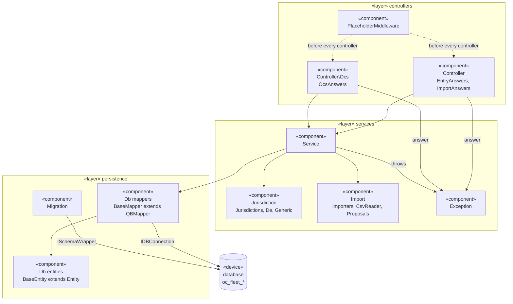

`PlaceholderMiddleware` refuses a body field named like a path placeholder before either controller runs.

### Other doors into the services

Nextcloud also calls the app through the interfaces `Application` registers, the jobs, commands and repair steps in `appinfo/info.xml`, and the jobs the app queues itself.
Some of them read the mappers directly, as an admin or as Nextcloud, where no user's access applies.

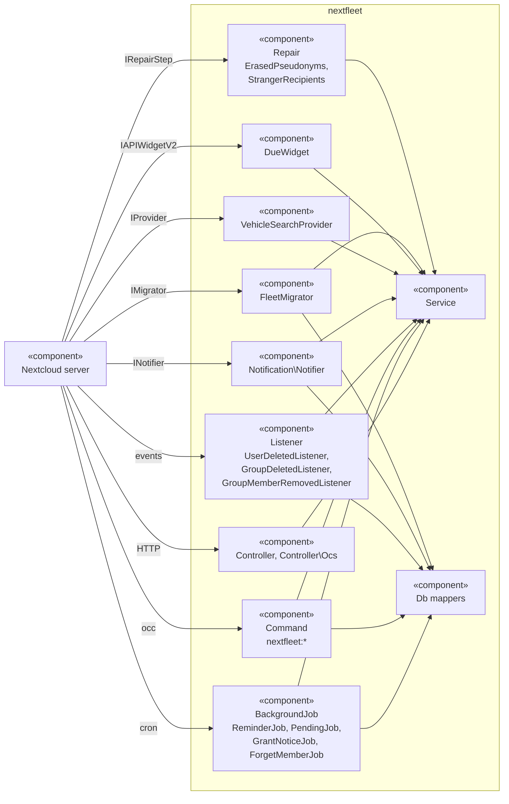

### Services by area

An arrow is a service another one gets in its constructor.
An unlabelled arrow into `VehicleService` is a call of `reach()`.
Mappers, `OCP` interfaces and the small helpers of `lib/Service` are left out.

#### Writes pass the gate

Every service that writes for a user reaches the vehicle through `VehicleService::reach()`, the one access check ([access](../architecture.md#access)).
An Entry with a counter settles it through `OdometerService` ([odometer rules](../architecture.md#odometer-rules)).

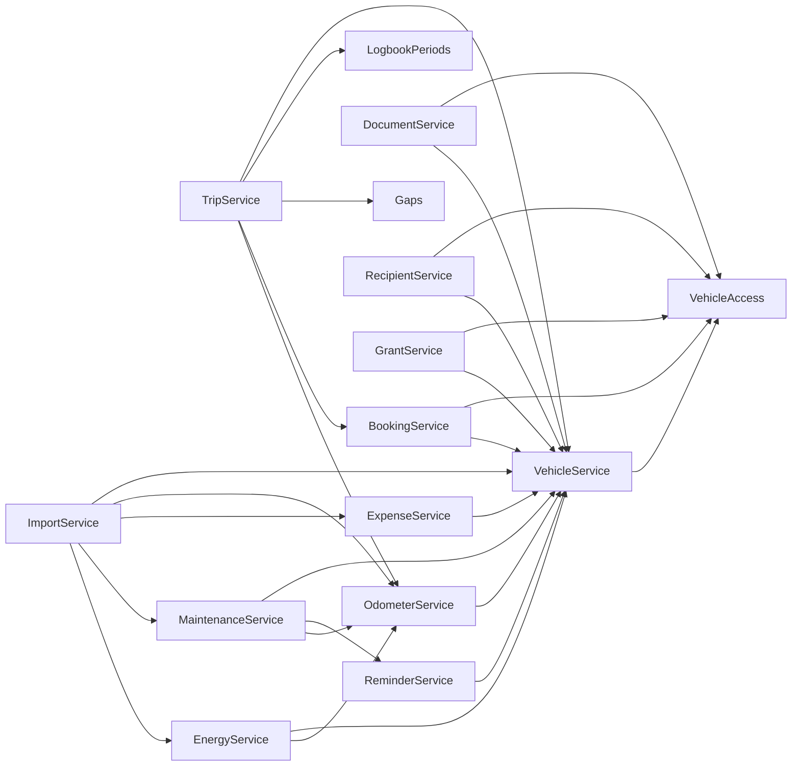

#### Reading the figures

What the timeline, the header and the exports compute.
Country rules come from `Jurisdictions` ([numbers](../architecture.md#numbers-consumption-cost-emissions), [reports and exports](../architecture.md#reports-and-exports)).

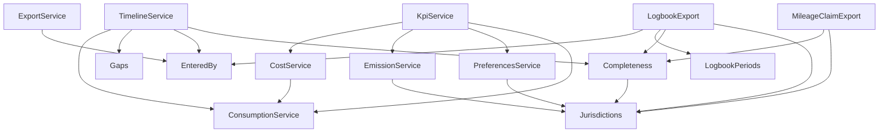

#### Reminders and notices

`ReminderEngine` is pure: it computes a state and stores nothing.
The `…Notices` classes write and withdraw notifications.
`Notifier` words them when they are read ([the reminder engine](../architecture.md#reminder-engine)).

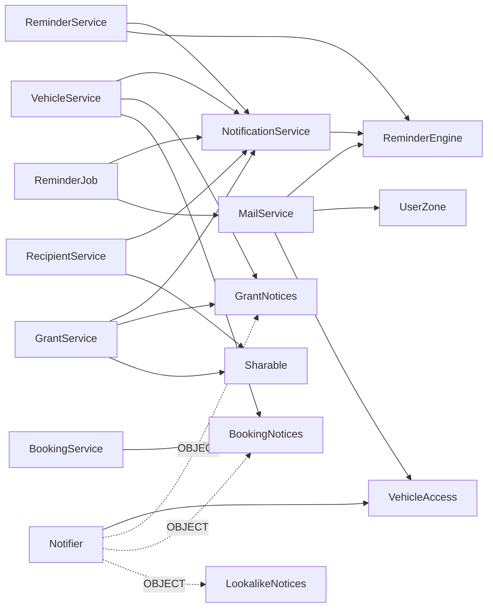

#### Accounts, checks and sync

What runs for an account, not a vehicle: erasing, transferring, the admin's check and the client's sync.
`Pending` records work a failure cut short ([deleting and erasing](../architecture.md#deleting-and-erasing), [sync](../api.md#sync)).

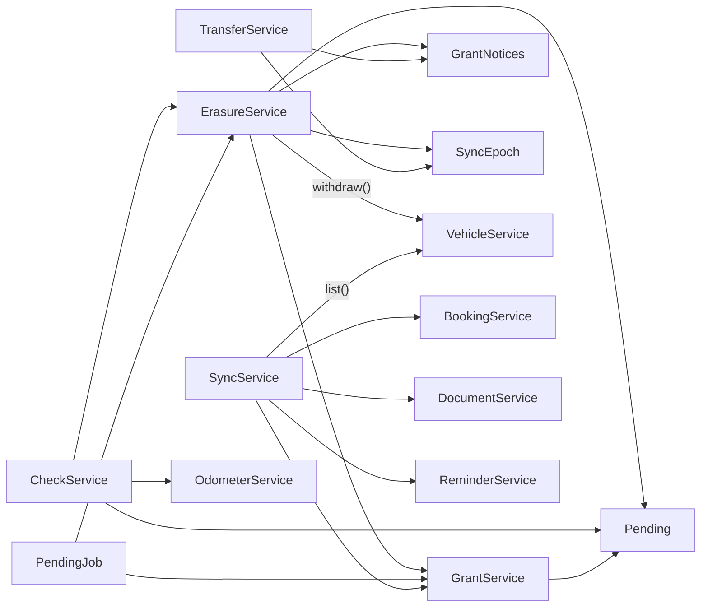

`SyncService` reads the epoch that `SyncEpoch` writes from the app config, not through the class.

## Frontend

Vue 3 with Pinia, two bundles.
The screens are in [screens](../ui.md#screens).

### Pages and screens

`main.js` mounts the fleet on `templates/main.php`.
`settings.js` mounts the settings block on `templates/personal.php`.
`App.vue` picks the view from the URL.

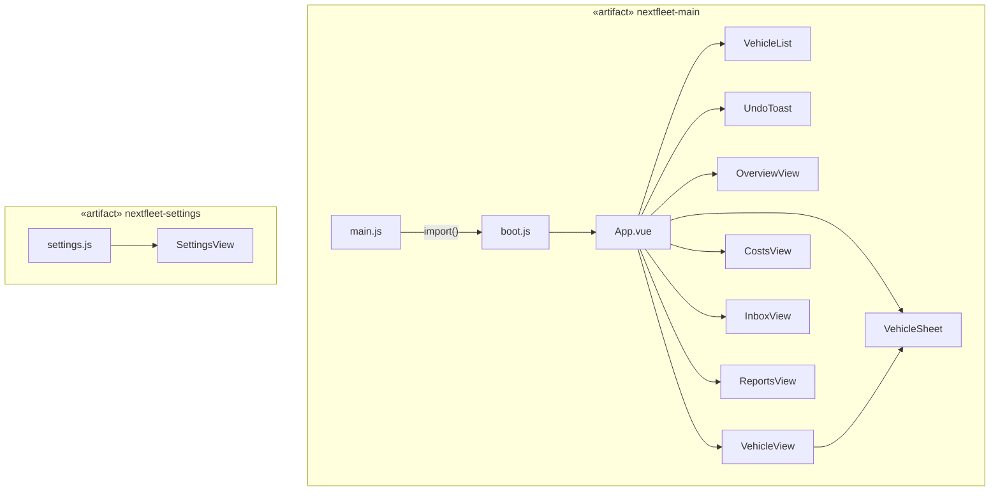

### The vehicle screen

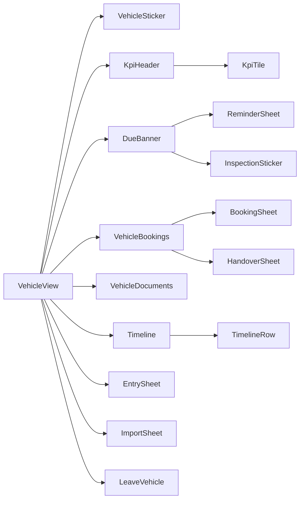

### The other screens

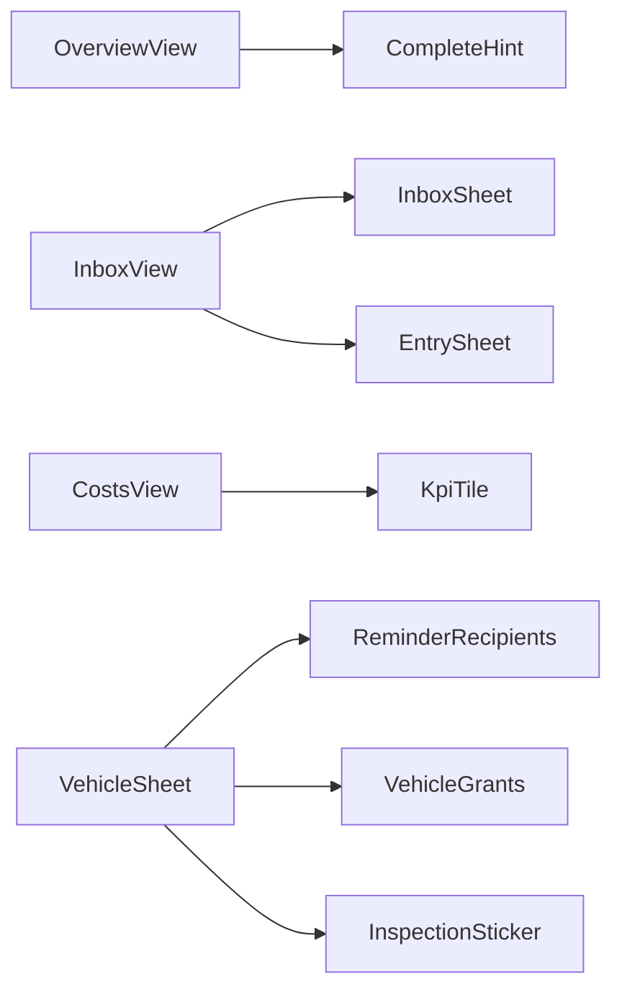

### State and the server

Three stores hold what more than one screen reads.
Everything else calls `services/api.js` itself.
Nothing else in `src/` talks to the server.

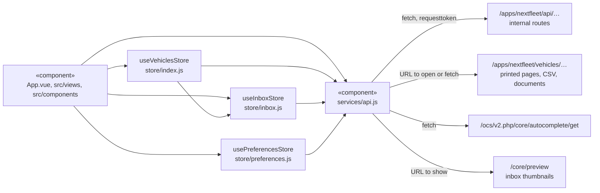

## A request

[One rule, two doors](../api.md#one-rule-two-doors): the browser and a client reach the same service call through twin controllers.
Here, logging a trip.
`EntryAnswers` or `OcsAnswers` turns a refusal into its status.

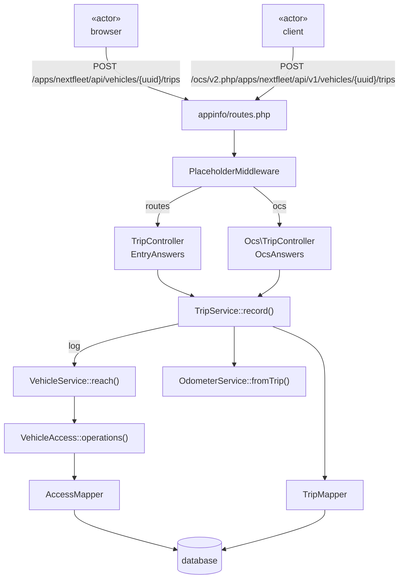

Next: [Domain](domain.md)
