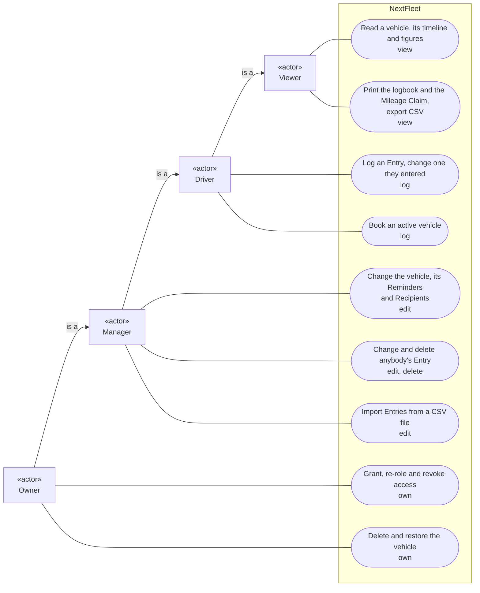
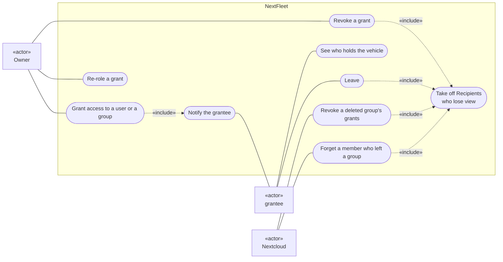
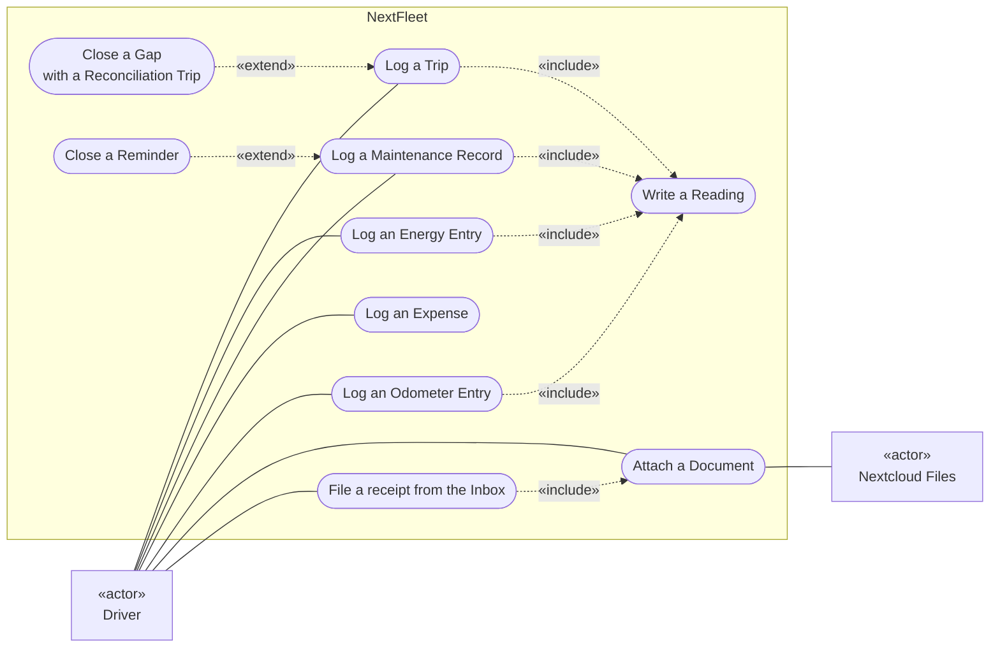
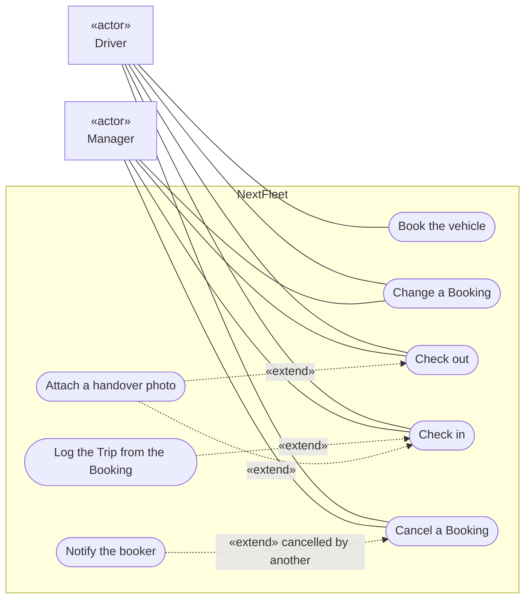
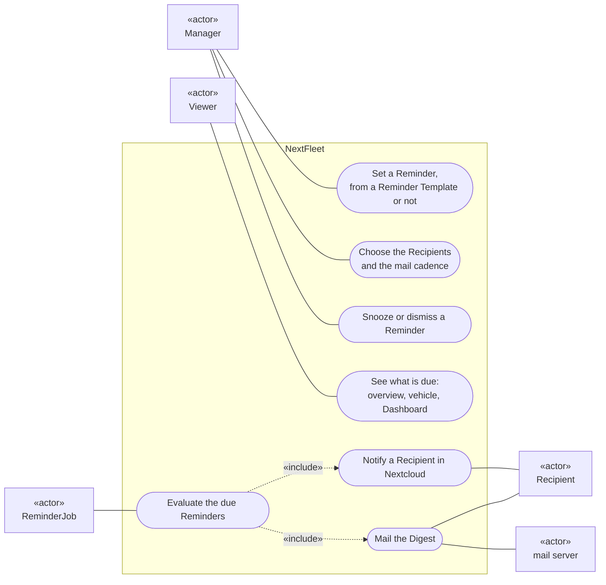
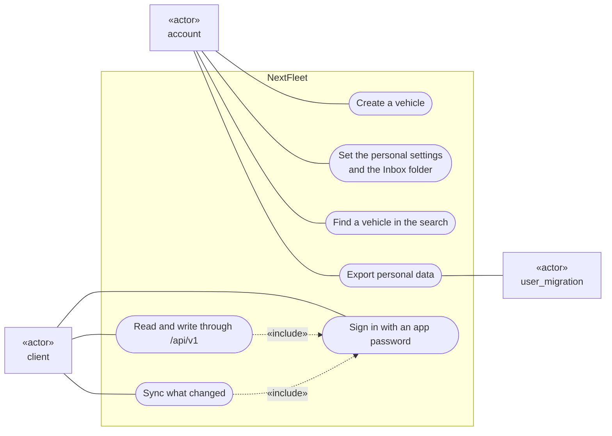
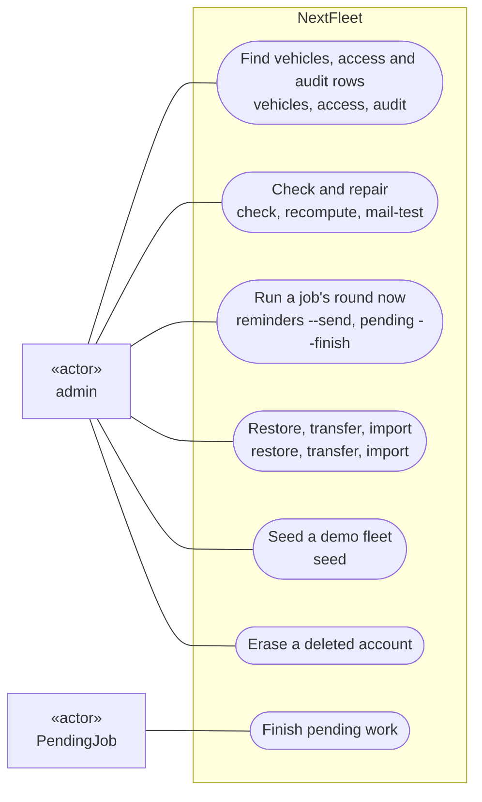
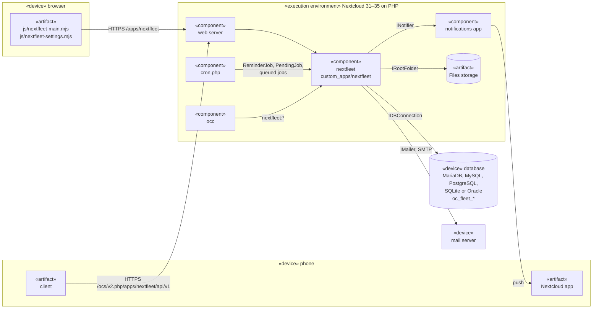

# Context

What NextFleet does for whom, and where it runs.
Read it first: the actors and their use cases, then the machines around the app.
[The index](README.md) explains the notation.

## Use cases

An actor is a role from [CONTEXT.md](../../CONTEXT.md), an account, a program or a timed job.

### By role

Each role can do all that the role it points to can, and more.
Each use case names the operation it needs.
Why each operation reaches that far is in [access](../architecture.md#access).
What each screen offers is in [screens follow the role](../ui.md#screens-follow-the-role).

### Access

A grantee is a user, or each member of a group, with a grant on a vehicle.
Nextcloud is an actor too: deleting a group or a membership ends what it reached.

### Entries and papers

Every Entry but an Expense writes a Reading.
A paper stays in its owner's Files.
The rules are in [odometer rules](../architecture.md#odometer-rules), [documents](../architecture.md#documents) and [the inbox](../architecture.md#the-inbox).

### Pool

A booking is the booker's.
A manager may change, cancel, check out and check in anybody's ([bookings](../architecture.md#bookings), [the Bookings section](../ui.md#the-bookings-section)).

### Reminders

`ReminderJob` runs hourly from Nextcloud's cron ([the reminder engine](../architecture.md#reminder-engine)).

### Accounts and clients

Any account may create a vehicle and so becomes its owner.
A client is a program that acts for one account through the [OCS API](../api.md), with an app password.

### Administration

The admin works through `occ` and Nextcloud's settings ([occ commands](../admin/occ.md)).
Deleting an account is Nextcloud's use case.
The app answers it by pseudonymising the rows ([ADR 0008](../adr/0008-erasing-a-driver-pseudonymises.md)).
`PendingJob` finishes work that a failure cut short.

## Deployment

One Nextcloud server, and no service of the app's own ([stack and layers](../architecture.md#stack-and-layers), [requirements](../admin/README.md#requirements)).

Next: [Components](components.md)
