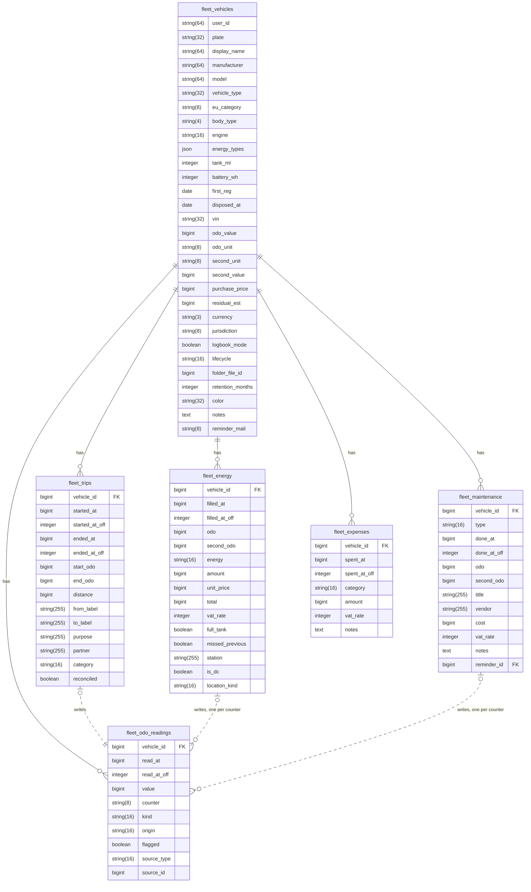
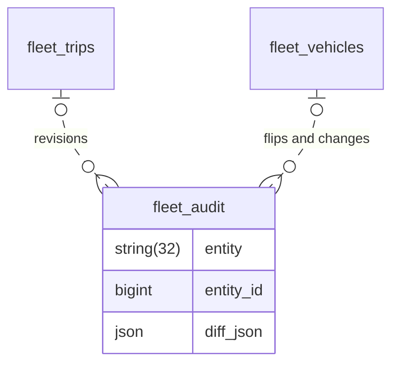
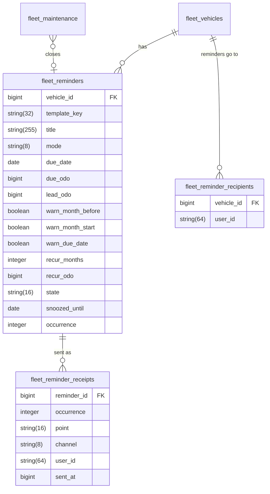
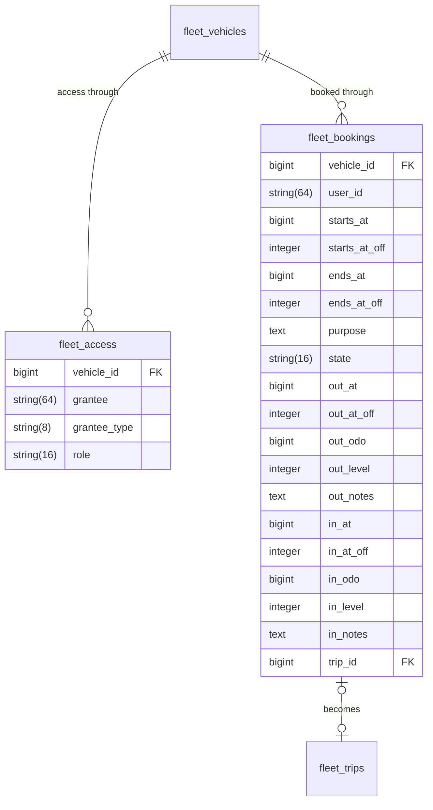
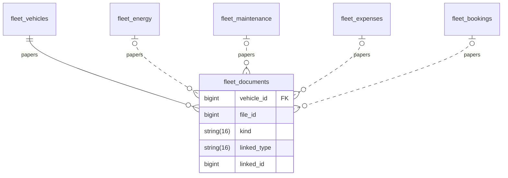

# Data model

The `fleet_*` tables, every column with its type, and how the rows point at each other, for someone
writing a migration or a query. One diagram per area; a table is drawn with its columns once and
named without them where another area points at it. [The data model](../architecture.md#data-model)
holds the rules and what each value means. [The index](README.md) explains the notation.

Every table also carries `id` (the key), `uuid`, `created_at`, `updated_at`, `deleted_at` and
`created_by` ([every table carries](../architecture.md#data-model)); the diagrams leave those out.
Types are Doctrine's, a string with its length in characters.

The database holds no foreign key. `FK` marks a column holding another row's `id`, drawn as a solid
line. A dashed line is a pointer by a type column and an id: `source_type` and `source_id`,
`linked_type` and `linked_id`, `entity` and `entity_id`.

## Vehicle and its entries

Each Entry that knows a counter writes a Reading, one per counter, and the vehicle caches the
newest value of each in `odo_value` and `second_value`
([odometer rules](../architecture.md#odometer-rules)). An Odometer Entry is a Reading with
`source_type` `manual` and no `source_id`. Each instant the user entered carries its offset in a
`_off` column ([time](../architecture.md#time)).

## The audit trail

A row about a trip or a vehicle, written in the same transaction as the change: a trip's revisions
under Logbook Mode, and a vehicle's mode flips and changes of plate, country, currency or type
([audit](../architecture.md#data-model)). It points by `entity` and `entity_id`, so it outlives
the row it describes.

## Reminders

A reminder belongs to a vehicle; a maintenance record may close one, which then recurs or is done
([reminder engine](../architecture.md#reminder-engine)). A receipt is one send: one row per
occurrence, warning point, channel and recipient, unique so a point sends once. The recipients are
per vehicle, not per reminder.

## Access and bookings

A grant names a user or a group in `grantee`, as `grantee_type` says; one live row per grantee, a
revoke soft-deletes it ([identity, ACL](../architecture.md#nextcloud-integration)). A booking is a
plan and writes no Reading; its handover is its own `out_*` and `in_*` columns, and `trip_id`
points at the trip logged from it ([bookings](../architecture.md#data-model)).

## Documents

A document points at its file by Nextcloud's `file_id`, never by path, and belongs to the vehicle
or to one fill-up, maintenance record, expense or booking
([documents](../architecture.md#documents)).

