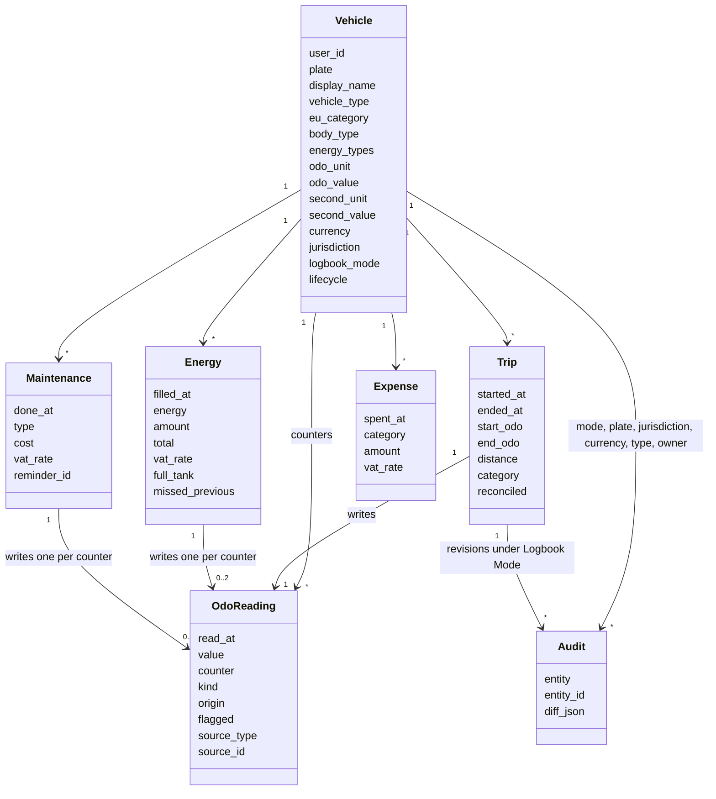
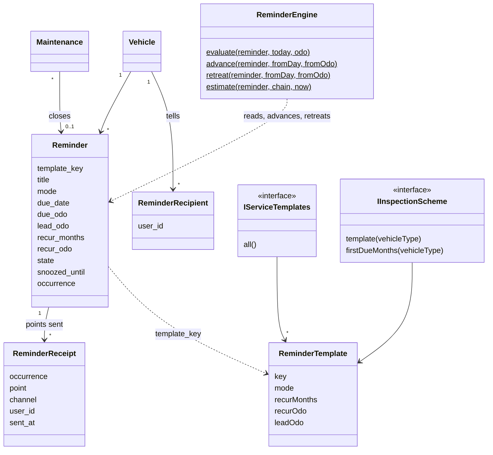
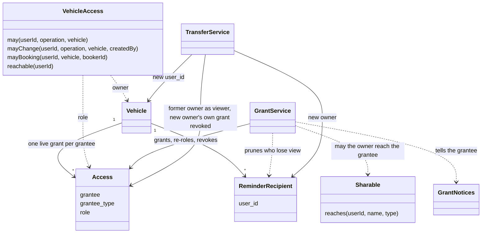
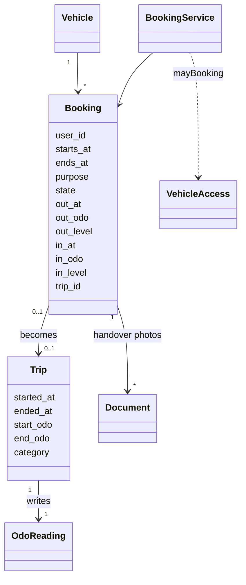
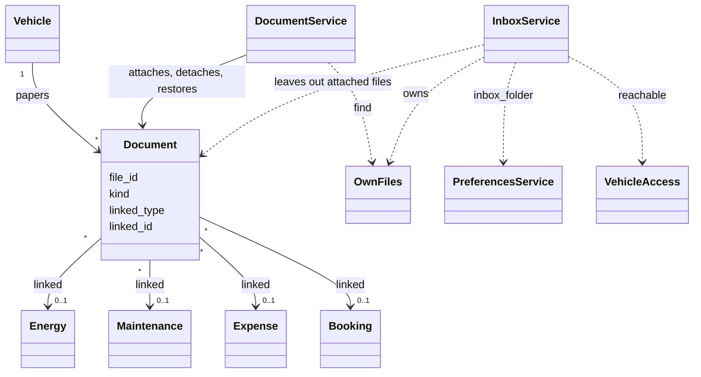
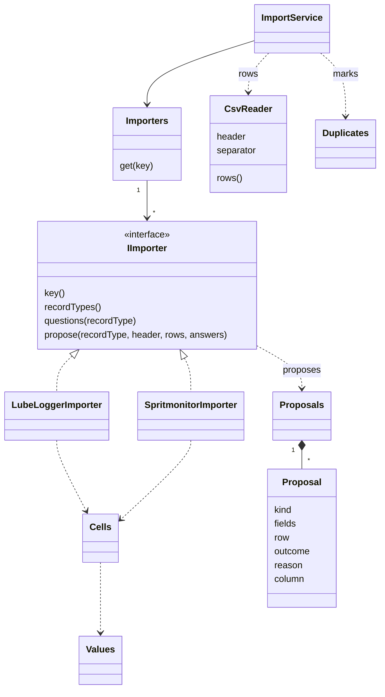
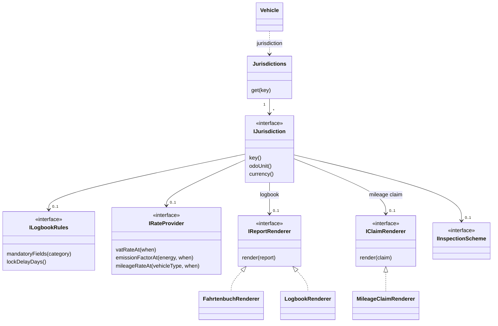

# Domain

The classes the rules are written against, and how they relate.
One diagram per area.
A class shows the attributes that identify it or that a rule reads.
[The data model](data-model.md) draws every column.
[The index](README.md) explains the notation.

Every entity extends `BaseEntity`, so it also has `uuid`, `created_at`, `updated_at`, `deleted_at` and `created_by`.
The diagrams leave those out.

## Vehicle and its entries

A vehicle's counters are chains of `OdoReading`s.
Each Entry with a counter writes its Reading, and the vehicle caches the newest value ([odometer rules](../architecture.md#odometer-rules)).
An Odometer Entry is a Reading with `source_type` `manual`.
The audit trail points at a trip or a vehicle by `entity` and `entity_id`, not by a key.

## Reminders

A reminder comes from a `ReminderTemplate` or has its own title.
`ReminderEngine` is static: it reads a reminder and the counter and answers the state and the newest warning point, and moves an occurrence on or back ([the reminder engine](../architecture.md#reminder-engine), [lifecycles](lifecycles.md#a-reminder)).
A `ReminderReceipt` records each point sent.
The recipients belong to the vehicle, not to a reminder.

## Access and sharing

The vehicle's `user_id` is its owner.
Everyone else reaches it through an `Access` grant with a role.
`VehicleAccess` alone turns the two into the five operations ([access](../architecture.md#access), [authorization](../security.md#authorization)).
`GrantService` grants only whom `Sharable` allows.
`TransferService` hands a vehicle to a new owner.

## Bookings, handover and trips

A `Booking` is a plan, not an Entry, and writes no Reading.
The handover is its `out_*` and `in_*` columns.
The driver logs the trip from a returned booking, and `trip_id` ties the two ([bookings](../architecture.md#bookings), [lifecycles](lifecycles.md#a-booking)).

## Documents and the inbox

A `Document` points at a Nextcloud file by `file_id`.
It hangs on the vehicle, or on one fill-up, maintenance record, expense or booking ([documents](../architecture.md#documents)).
`InboxService` lists the inbox files that no live Document references yet ([the inbox](../architecture.md#the-inbox)).

## Import

An importer reads one tool's CSV export and proposes entries.
It writes nothing.
`ImportService` reads the file through `CsvReader`, marks `Duplicates`, and writes what the user agreed to through each entry service's `add()` ([import](../architecture.md#import)).

## Jurisdiction

A vehicle names its jurisdiction by key.
`Jurisdictions` resolves it, and falls back to `generic` for a key it does not know.
A part a jurisdiction lacks is null, and a report that needs it is unavailable ([contributing](../contributing.md#still-one-directory-per-country)).

Next: [Data model](data-model.md)
