# Flows

The key requests and jobs, step by step, from the browser, client or timer to the database and
back. Read it to see which class does what in what order, before changing one of them. The access
check and the OCS request come first, since every other flow passes them. Mappers are drawn as the
database, each message naming the mapper call. [The index](README.md) explains the notation.

## The access check

`VehicleService::reach()` is the one gate on a vehicle; `VehicleService::change()` is the second
gate, on the Entry the route names. Editing a fill-up as an example. Each operation, role and
reason is in [Nextcloud integration](../architecture.md#nextcloud-integration) and
[authorization](../security.md#authorization).

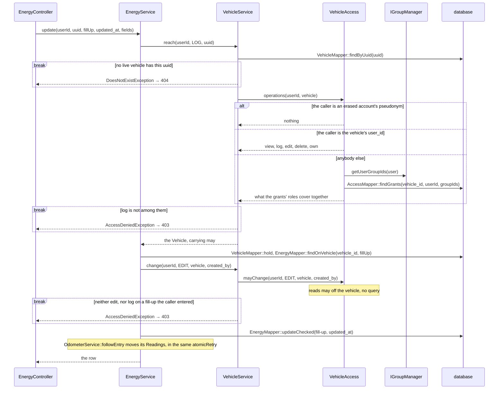

A fill-up of another vehicle is not found by `findOnVehicle`, so it is a 404 too. A booking passes
`VehicleAccess::mayBooking()` in the second gate's place, with the booker for `created_by`.
`EntryAnswers` and `OcsAnswers` turn each exception into its status.

## A request with an app password

A client signs in with an app password over Basic auth ([signing in](../api.md#signing-in)).
Nextcloud checks it and the limits before the app runs; the app's middleware and the OCS twin of
the web controller come after. The same edit as above, through the OCS door. The statuses are in
[answers](../api.md#answers), the limits in [rate limits](../api.md#rate-limits), the token in
[writes and tokens](../api.md#writes-and-tokens).

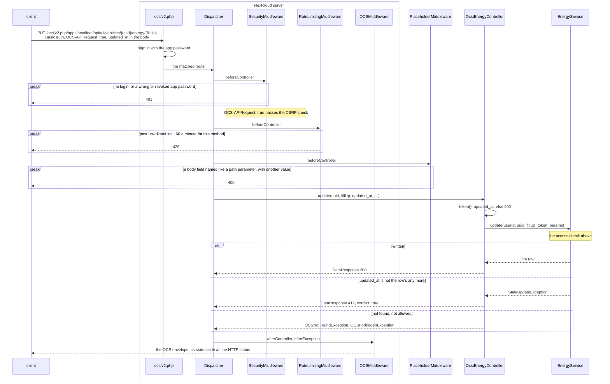

The web door is the same from the dispatcher on, with `EnergyController` and `EntryAnswers`; its
CSRF check takes the session's `requesttoken`.

## A fill-up and its figures

### Saving it

The entry sheet posts the fill-up; the service writes it and its Readings under the vehicle's
hold, in one transaction. A retried create is answered, not written again
([retried creates](../api.md#retried-creates), [concurrency](../architecture.md#concurrency)). How a
Reading is flagged is in [odometer rules](../architecture.md#odometer-rules).

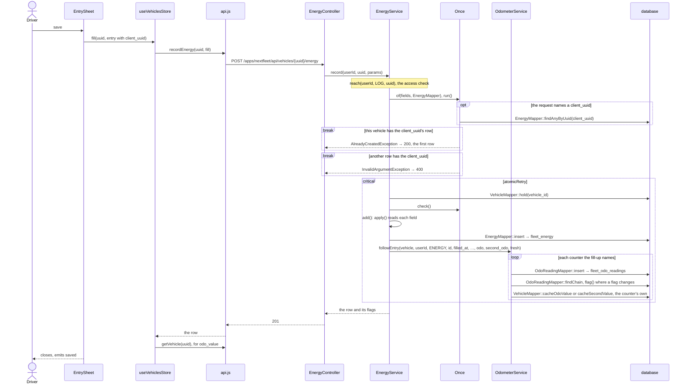

A field the service refuses is a 400 and the sheet stays open with what was typed
([the entry sheet](../ui.md#the-entry-sheet-in-detail)).

### The figures it moves

On `saved`, the vehicle screen reloads its timeline, its KPI header and its bookings; the bookings
are left out here. The first two read the same
segments from `ConsumptionService`, worked out on read and never stored
([numbers](../architecture.md#numbers-consumption-cost-emissions),
[the timeline](../architecture.md#the-timeline)). The calls go through `api.js`, left out here.

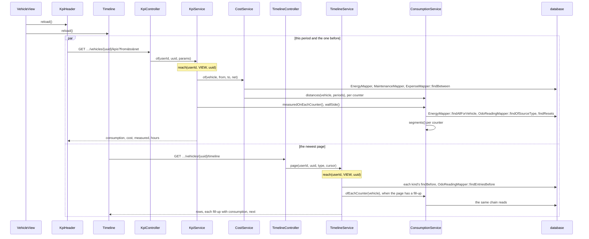

## A booking to its handover

A driver books a vehicle, takes it, brings it back, and logs the trip from the booking. Booking and
handover write `fleet_bookings` only; the trip writes the Reading. The rules are in the data
model's bookings paragraphs ([data model](../architecture.md#data-model)), the states in
[Pool](../../CONTEXT.md).

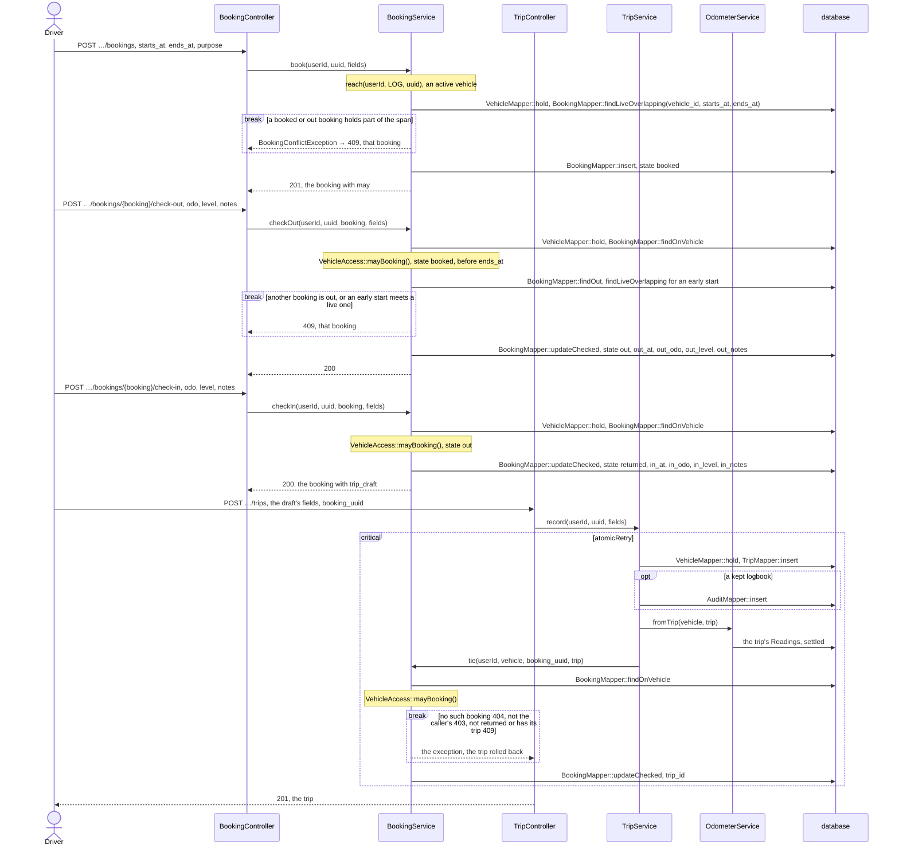

Neither handover takes the `updated_at` token. Check-in passes on any lifecycle: a car laid up while
out still comes back. A cancel by anybody but the booker notifies the booker
(`BookingNotices::tellCancelled`).

## The reminder round

`ReminderJob` runs hourly and hands the round to `NotificationService`, then to `MailService`.
Every rule is in [the reminder engine](../architecture.md#reminder-engine): the state at an
instant, who is told, the job and the digest.

### The notifications

Each vehicle is evaluated under its hold, one transaction each. A receipt is claimed before the
send, and the send waits for the commit, so a second run sends nothing and a rollback leaves no
notice without its receipt.

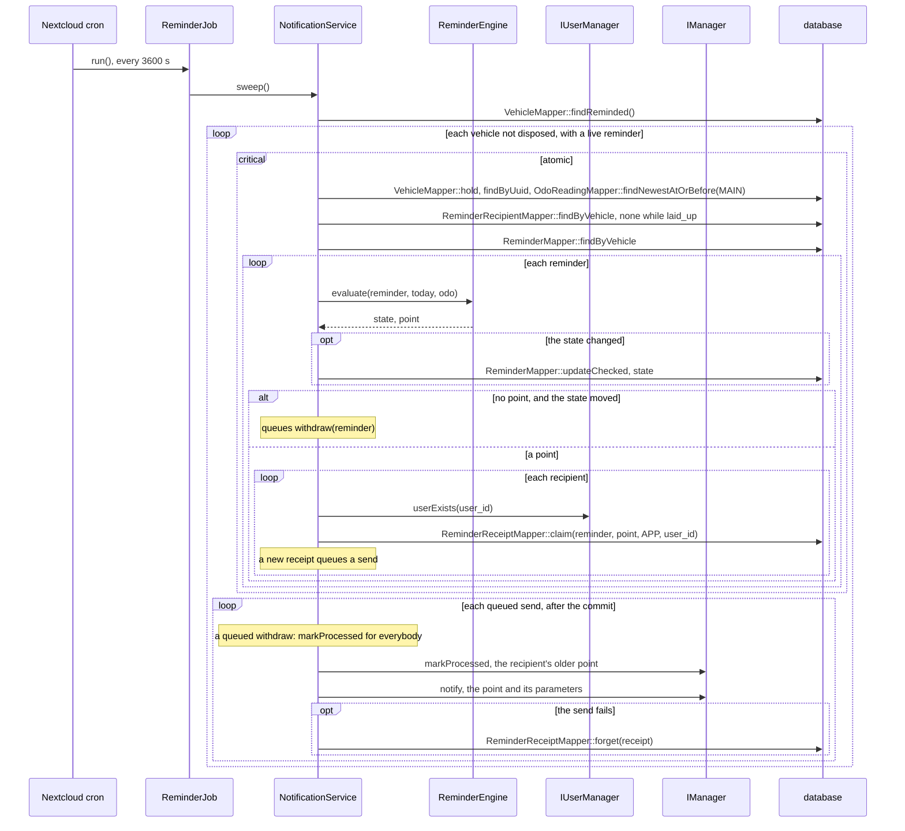

A vehicle or a send that fails is logged and the round goes on. Snoozing, dismissing and deleting
withdraw through `NotificationService::withdraw()` too, from `ReminderService`.

### The digest

After the notifications, at most one mail a day per recipient, from 07:00 in their zone, on the
days each vehicle's `reminder_mail` names, with the points this user has no `mail` receipt for.

```mermaid
sequenceDiagram
    participant Job as ReminderJob
    participant Mail as MailService
    participant Zone as UserZone
    participant Config as IConfig
    participant Engine as ReminderEngine
    participant Mailer as IMailer
    participant db as database
    Job->>Mail: digest()
    Mail->>db: VehicleMapper::findReminded(), with each recipient list
    Mail->>Config: getUserValueForUsers(digest_checked)
    loop each recipient, enabled, with an address
        Mail->>Zone: of(user_id)
        break before 07:00 their time, or this day checked with the same vehicles
            Note over Mail: next recipient
        end
        Mail->>db: ReminderReceiptMapper::lastSent(user_id, MAIL)
        alt not mailed today, and a vehicle's reminder_mail falls today
            loop each such vehicle, one transaction each
                Mail->>db: VehicleMapper::hold, findByUuid, ReminderMapper::findByVehicle
                Mail->>db: OdoReadingMapper::findNewestAtOrBefore(MAIN)
                loop each reminder
                    Mail->>Engine: evaluate(reminder, today, odo)
                    Mail->>db: ReminderReceiptMapper::claim(reminder, point, MAIL, user_id)
                end
            end
            opt news
                Mail->>Mailer: createEMailTemplate, send: ReminderWords lines under each VehicleWords::name
                Note over Mail: a vehicle linked only where the reader may view it
            end
            break the mail fails
                Mail->>db: ReminderReceiptMapper::forget(claimed)
                Note over Mail: logged, next recipient, day not marked
            end
        end
        Mail->>Config: setUserValue(digest_checked, day and vehicles)
    end
```

### Reading a notice

A reminder notice stores parameters. `Notifier::prepare()` words them when they are read, and drops
one that no longer stands.

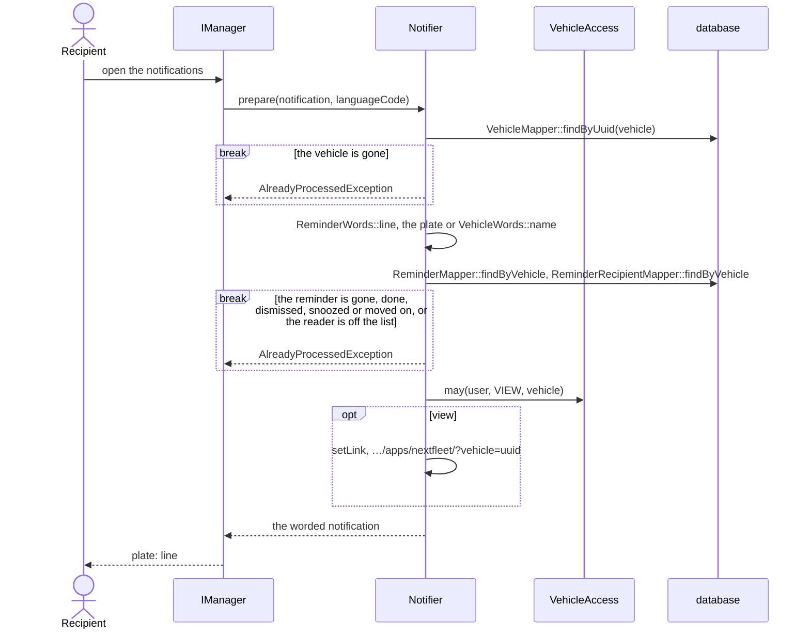

## An import

Another tool's CSV, picked in the caller's Files, becomes entries in two requests. Nothing is kept
between them: the import sends the preview's body again with the file's `etag` and the file is read
again. Every rule is in [import](../architecture.md#import); the classes are in
[domain](domain.md#import).

### The preview

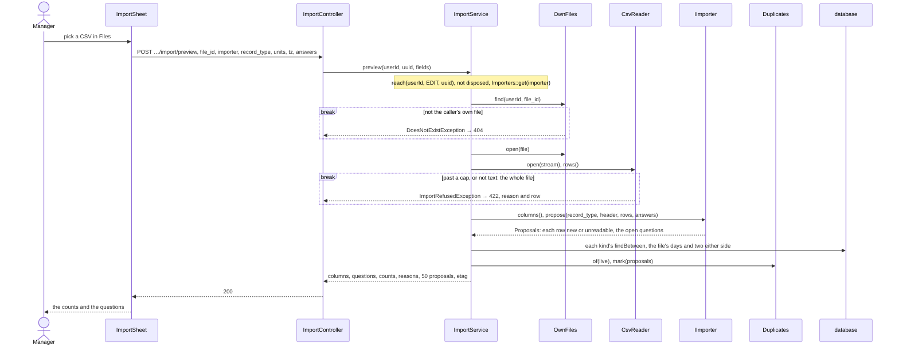

A file being written is a 423. Each answer the user gives previews again.

### The import

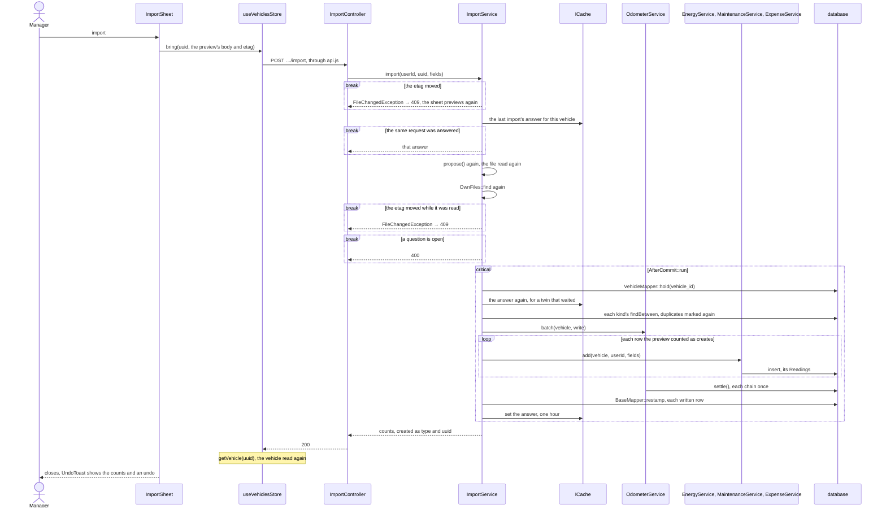

An odometer row goes through `OdometerService::add()` instead. A row a service refuses stops the
whole import with a 400 naming the row, and the cache entry goes.
`occ nextfleet:import` sends the same two calls through `ImportService` as the user it names.

## A personal data export

Nextcloud's *user_migration* app exports an account through `FleetMigrator`. What is exported
whole and what is withheld is in [personal data export](../architecture.md#personal-data-export).

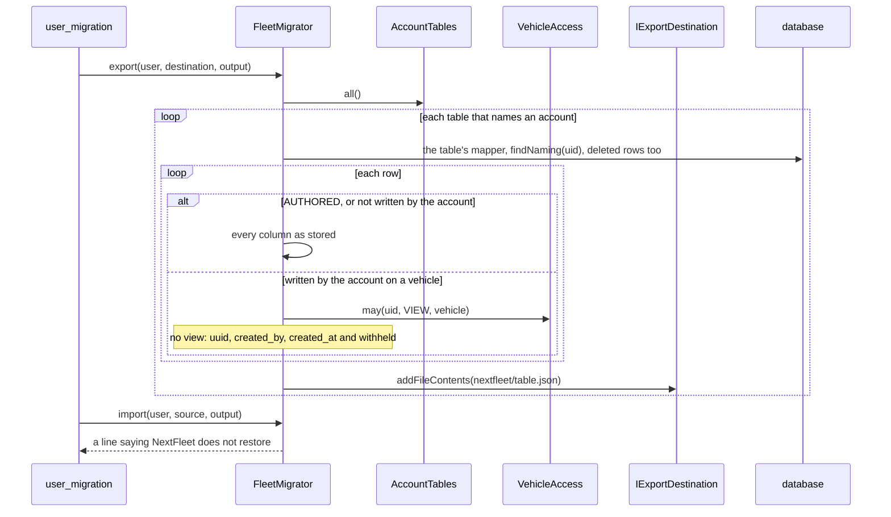

The import reads nothing from the source and writes nothing, so another app's import runs on.
