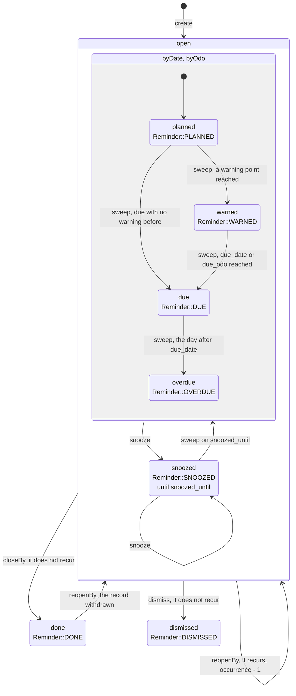
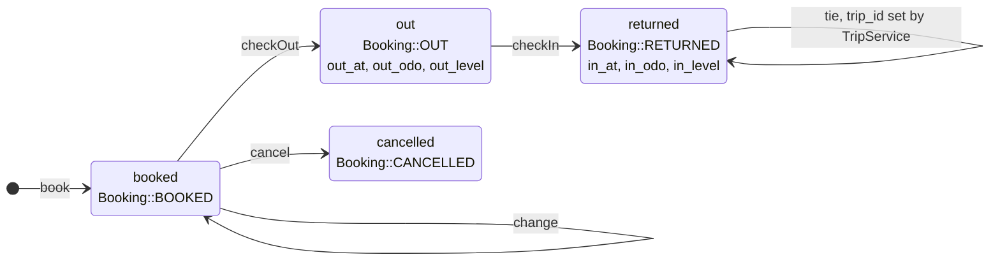
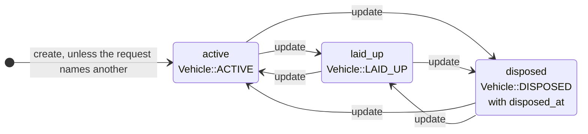
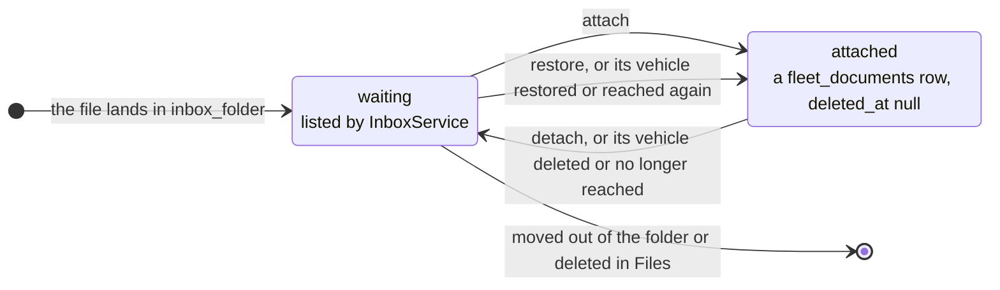
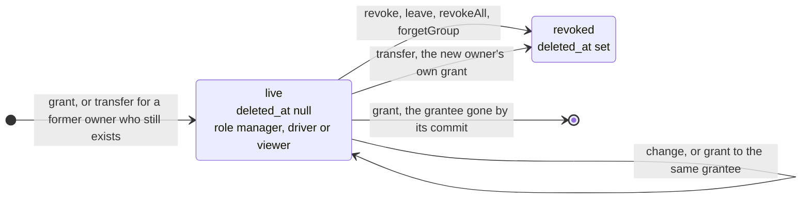

# Lifecycles

The states a row goes through, and the calls that move it.
A state is spelled as stored.
The line below it names the constant that holds it.
[The index](README.md) explains the notation.

## A reminder

`state` in `fleet_reminders`.
Each sweep stores what `ReminderEngine::evaluate()` returns, so a sweep may skip a state, and an edit or a corrected Reading may move it back.
Done and dismissed end the occurrence.
A recurring reminder starts the next one instead ([the reminder engine](../architecture.md#reminder-engine)).

`closeBy` is a maintenance record that names the reminder.
`reopenBy` takes it back when the record is deleted or changed.
A recurring reminder taken back steps back one occurrence (`ReminderEngine::retreat`).
Delete and restore leave `state` as it is.

## A booking

`state` in `fleet_bookings`.
Only `booked` and `out` hold the vehicle (`Booking::LIVE`).
Nothing leaves `cancelled` or `returned` ([bookings](../architecture.md#bookings)).

## A vehicle

`lifecycle` in `fleet_vehicles`.
Any state may follow any other.
Deleting sets `deleted_at` and leaves `lifecycle` as it is.

## A receipt in the inbox

No column holds this state: `InboxService` works it out on each read.
The app never moves a file ([the inbox](../architecture.md#the-inbox)).

## A grant

A row in `fleet_access`.
A revoke sets `deleted_at`, and nothing restores it: granting again writes a new row.
A grant whose grantee was gone by the commit is deleted outright ([access](../architecture.md#access)).

Back to the [index](README.md).
