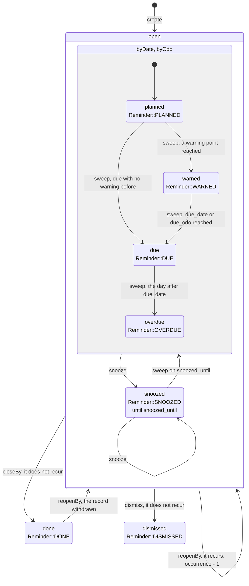
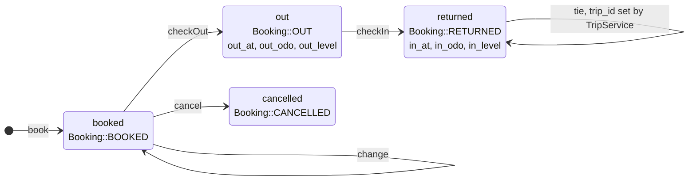
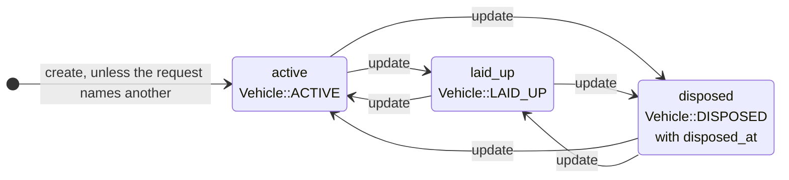
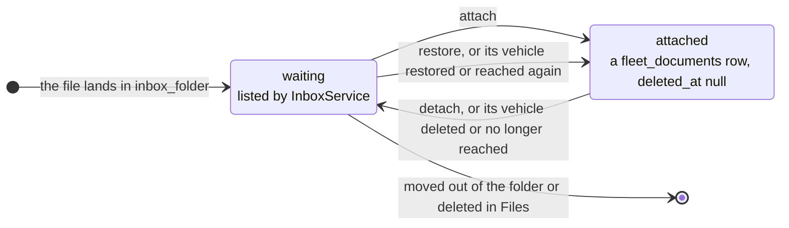
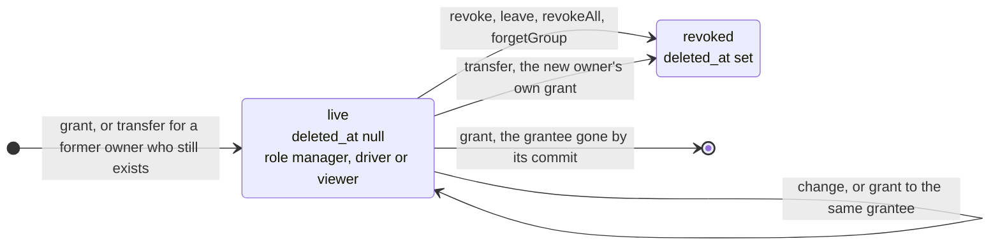

# Lifecycles

The states a row goes through and the calls that move it, for whoever adds a state or a transition.
A state is spelled as the value stored; the line below it names the constant or the column that
holds it. A transition names the method that makes it. [The index](README.md) explains the
notation.

## A reminder

`state` in `fleet_reminders`. While the occurrence is open, each sweep of a vehicle not disposed of stores what
`ReminderEngine::evaluate()` returns: where the reminder stands by date and by km, or snoozed. So a
sweep may skip a state, say from `planned` to `overdue`, and an edit or a corrected Reading can
move it back. Done and dismissed end the occurrence;
a reminder that recurs starts the next one instead, evaluated afresh. The rules are in
[the reminder engine](../architecture.md#reminder-engine).

`closeBy` is a maintenance record that names the reminder in its `reminder_id`. `reopenBy` takes
it back when the record is deleted or names another reminder, and when its day or counter changes,
which then closes it again from there; `recloseBy` closes it again when the record is restored. A
recurring reminder taken back steps back one occurrence (`ReminderEngine::retreat`). `delete` sets
`deleted_at`, `restore` clears it, and both leave `state` as it is.

## A booking

`state` in `fleet_bookings`. Only `booked` and `out` hold the vehicle (`Booking::LIVE`). The
handover writes the `out_*` and `in_*` columns; no write leaves `cancelled` or `returned`. The rules
are in [the data model](../architecture.md#data-model), the screens in
[the bookings section](../ui.md#the-bookings-section).

## A vehicle

`lifecycle` in `fleet_vehicles`. Any state may follow any other: `update` takes the field like any
other, and the edit sheet clears `disposed_at` with any state but `disposed`. Deleting a vehicle sets
`deleted_at` and leaves `lifecycle` as it is. What each state stops is in
[the data model](../architecture.md#data-model) and [the reminder engine](../architecture.md#reminder-engine).

## A receipt in the inbox

No column holds this state: `InboxService` works it out on each read. An image or PDF of the user's
own in their inbox folder waits while no live `fleet_documents` row on a live vehicle they reach
references it. The app never moves a file. The rules are in [the inbox](../architecture.md#the-inbox) and
[documents](../architecture.md#documents).

## A grant

A row in `fleet_access`. It is live from the insert, with its `role`; a revoke sets `deleted_at`,
and nothing restores it: granting again writes a new row. `took()` deletes a row outright when its
grantee was gone by the commit. Erasing the grantee's account keeps a user grant live under the
pseudonym in `grantee`. The rules are in
[Nextcloud integration](../architecture.md#nextcloud-integration) and
[the data model](../architecture.md#data-model).

