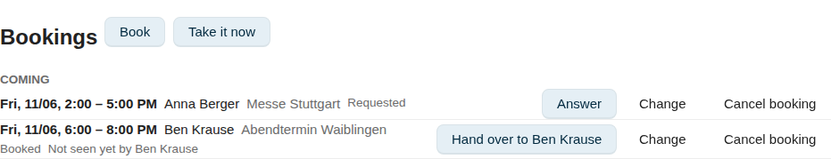
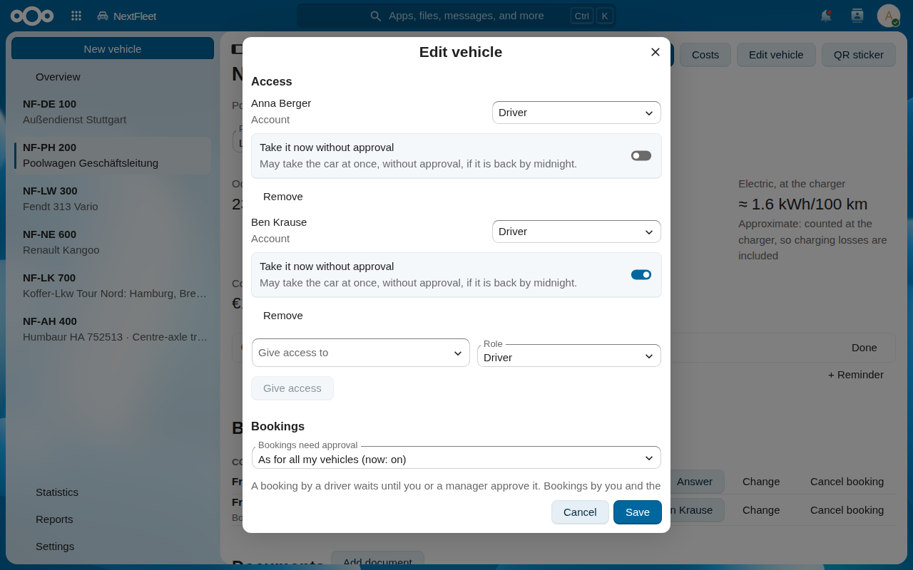
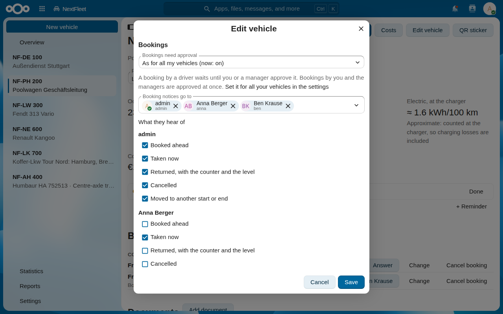

# Access and bookings

The owner of a vehicle can give access to other users and groups.
With access, a driver can book the vehicle, take it and return it.

## Set up a pool car

A pool car is a vehicle that several drivers book.
Do these steps in this order:

1. [Add the vehicle](vehicles.md#add-a-vehicle).
2. [Give access](#give-access) to each driver, or to a group of drivers.
   The **Bookings** section shows in **Edit vehicle** after this step.
3. Decide if [bookings need approval](#approve-bookings).
4. Decide if a driver needs approval also for [Take it now](#take-it-now-without-approval).
5. Decide [who hears of bookings](#hear-of-bookings).
6. If necessary, [book the car for a driver](#book-for-a-driver).

A vehicle that only you use shows none of these settings.

## Roles

| Role | Can |
|---|---|
| **Viewer** | See the vehicle, its entries, figures, reminders and documents. Export CSV files. See the costs, unless the owner keeps them from drivers and viewers. |
| **Driver** | All a viewer can. Add entries, and change or delete their own. Book the vehicle. Attach documents to their own entries and bookings. |
| **Manager** | All a driver can. Always see the costs. Change and delete all entries and bookings, and answer the ones that wait for approval. Book the vehicle for a driver. Edit the vehicle, its reminders and who gets them. Attach documents to the vehicle. Import. |
| Owner | All a manager can. Give and remove access. Decide whether drivers and viewers see the costs, whether bookings need approval, which driver can take the vehicle without approval, and who hears of bookings. Delete the vehicle. |

The owner is the user who added the vehicle.
Only an administrator can give it to another owner.
With more than one grant, the strongest role applies.
Every role sees the whole vehicle, every trip with its purpose included.
In [Statistics](statistics.md#statistics), only the owner and the managers see the figures of each driver.
Drivers and viewers see their own figures.

## Keep the costs from drivers and viewers

You must be the owner.
The switch shows only after you gave access to another user or a group.

1. Click **Edit vehicle**.
2. Under **Costs**, switch off **Drivers and viewers see costs**.
3. Click **Save**.

Drivers and viewers then see no sums, no prices and no expenses of other users, and no mileage claim.
They still enter amounts, and see the amounts they entered.
On the timeline, **Expenses** shows the expenses they entered.
A receipt shows the price, so they see no document on another user's fill-up, maintenance or expense either.
They also see no receipt on the booking of another user and no receipt on the vehicle itself.
The other documents on the vehicle stay visible, for example the registration and the insurance.
To hide a purchase invoice or a leasing contract, file it as a receipt on the vehicle.
If it is already on the vehicle as a different kind, remove it first and attach it again.
The owner and managers always see the costs.

## Give access

You must be the owner.

1. Click **Edit vehicle** and go to **Access**.
2. In **Give access to**, select a user or a group.
3. In **Role**, select **Viewer**, **Driver** or **Manager**.
4. Click **Give access**.

   The change saves at once.
   The user gets a notification.

You can give access only to the users and groups that your administrator lets you share with.
To change a role, select another one.
To end access, click **Remove**, then **Remove access**.

## Leave a vehicle

On a vehicle of another user, click **Leave vehicle** under the name, then **Leave**.
Only the owner can give you access again.
Access through a group stays.
Only the owner can change it.

**Who can see this vehicle**, under the name, lists everyone with access.

## Book a vehicle

**Bookings** shows only on a vehicle that another user has or had access to.
Drivers, managers and the owner can book.

1. In **Bookings**, click **Book**.
2. Type the **Start**, the **End** and the **Purpose**.
3. Click **Book**.

If someone else has the vehicle at that time, NextFleet tells you who.
A booking starts now or later, lasts 90 days at most, and ends within one year.
Nobody books a vehicle that is laid up or disposed of.

To change or cancel your booking, click **Change** or **Cancel booking**.
A manager and the owner can do this for all bookings.
If someone else cancels your booking, you get a notification.

### Book for a driver

The owner and the managers can book a vehicle for another user.
Use this when you plan the vehicle for a driver.
**For** shows only when another user can book the vehicle.

1. In **Bookings**, click **Book**.
2. In **For**, select the driver.
   **For** lists all users who can book the vehicle.
   **Me** books for you.
3. Type the **Start**, the **End** and the **Purpose**.
4. Click **Book**.

The booking belongs to the driver.
It does not wait for approval.
The driver gets a Nextcloud notification with the button **Seen**.
The driver clicks **Seen** to tell you that they know of the booking.
Until then, the booking shows **Not seen yet by** and the driver's name.
**Not seen yet by** shows until the driver takes the car.
The booking stays, also when the driver does not click **Seen**.

The driver sees **Booked for you by** and your name on the booking.
The driver can change or cancel it as their own booking.
If bookings need approval and the driver changes the start or the end, the booking waits for approval again.
If the driver cancels it, you get a notification.

### Approve bookings

The owner can make a driver's booking wait for an answer.
Bookings by the owner and the managers are approved at once.

To decide it for all your vehicles at once:

1. Open **Settings** in the NextFleet navigation.
2. Under **Bookings**, switch on **Bookings need approval**.

You see this switch only after you gave access to another user or a group.
It applies to each vehicle that is set to **As for all my vehicles**.
A new vehicle is set to **As for all my vehicles**.

To decide it for one vehicle:

1. Open **Edit vehicle**.
2. Under **Bookings**, select an option in **Bookings need approval**:
   - **As for all my vehicles** does what the switch in **Settings** says.
     The option shows if the switch is on or off now.
   - **Always** makes bookings wait for approval.
   - **Never** lets bookings go through at once.
3. Click **Save**.

A booking that waits also holds its time.
On your booking, you see **Waiting for approval**.
Other users see **Requested**.
The owner and the managers get a notification, and the booking shows **Answer**.

1. Click **Answer**.
2. Type a comment for the driver, if you like.
3. Click **Approve**, **Ask back** or **Decline**.

The driver gets a notification and sees the comment on the booking.
Only the driver, the owner and the managers see the comment.
**Decline** cancels the booking.
In the list, the booking then reads **Declined**.

**Ask back** keeps the booking waiting, for the driver to change or cancel it.
In the list, it reads **Asked back**.
The driver sees the question in the notification and in **Change booking**.
Under the vehicle's name, it reads **Your booking, asked back**.
When the driver saves a change, the question is answered and the booking waits for approval again.
On a booking that is asked back, a new purpose alone is also an answer.

- A waiting booking cannot be taken, even once its time has come.
  The owner and the managers can still answer it.
  If it is not approved by its end, it is declined.
- When the driver sets a new start or end, the booking waits again, also when it was approved.
  When the owner or a manager sets it, the booking is approved.
  A new purpose alone changes nothing on an approved booking.
- When a vehicle no longer asks for approval, every booking that waits on it is approved.
  A new option on the vehicle can cause this.
  The switch in **Settings**, switched off, can also cause this.
- When an administrator gives a vehicle to a new owner, its approval stays as it was.
- When the owner makes a user or a group a manager, each new manager gets a notification for each request that waits.
  A new owner gets them too.
  A booking that is asked back waits for the driver, so it sends no notification to them.
  A user who joins a group that is a manager already gets them only for bookings made after that.
- The people on the booking notices list hear of a booking only once it is approved.

### Take it now without approval

**Take it now** books the car from now and takes it in one step ([Take and return a vehicle](#take-and-return-a-vehicle)).
On a vehicle that asks for approval, **Take it now** needs no approval if the car is back by midnight.
Kept longer, it is a booking that waits like any other.
The sheet then says so and the button reads **Request**.

You can stop one driver from taking the car without approval.
Do this when you want to approve each use of the car by that driver, also a short one.

1. In **Edit vehicle**, go to **Access**.
2. On the row of that driver, switch off **Take it now without approval**.
   The change saves at once.

Each **Take it now** by that driver is then a request that waits for approval.
The switch shows only on driver rows, and only while the vehicle asks for approval.
The owner and the managers always take the car without approval.
If a driver has access by name and through a group, one switch that is on is enough.

### Hear of bookings

The owner decides who gets a notification when a vehicle is booked or taken.
Each person or group on the list can hear different events.
For example, you hear of all events, and your drivers hear only when somebody takes the car now.

With nobody on the list, the list shows one row: **You (owner)**.
Then the notices go to you.

1. In **Edit vehicle**, go to **Bookings**.
2. To add a person or a group, select it in **Booking notices go to**.
   The first person or group on the list gets the ticks of **You (owner)**, even if you did not save them.
   A person or group that you add later gets the ticks that you saved for **You (owner)**.
3. Under **What they hear of**, tick the events for each person or group:
   - **Booked ahead** tells of a new booking.
   - **Taken now** tells that somebody takes the car at once.
   - **Returned, with the counter and the level** tells of a return.
   - **Cancelled** tells of a cancelled booking.
   - **Moved to another start or end** tells of a change of the times.
4. To remove a person or a group, remove it from **Booking notices go to**.

The ticks of a person or a group save at once.
The ticks of **You (owner)** are a setting of the vehicle.
Click **Save** to keep them.

When the list has a person or a group on it, you get no booking notices yourself.
To get them, select your own name in **Booking notices go to**.
Your name is the first option in **Booking notices go to** until you add it.
You still get the requests that wait for approval.

A person who is on the list two times, by name and through a group, gets each event one time.
Only people who can see the vehicle get the notices.
Nobody gets a notice of what they did themselves.

## Take and return a vehicle

1. On your booking, click **Take the car**.
2. Type the **Counter reading** and the **Tank or battery (%)**.
   You can add **Notes**.
3. Click **Take the car**.
   The booking shows **Out**.

A manager and the owner can hand the car over on the booking of another user.
The button then reads **Hand over to** and the driver's name.

Without a booking, use **Take it now** and type when you are **Back by**.
It shows only while nobody has the vehicle.
If bookings need approval, read [Take it now without approval](#take-it-now-without-approval).

To return it, click **Return the car** on the booking and type the reading and the level.
The entry form then opens a trip with the times, the readings and the purpose of the booking.
Select the **Category** and click **Save**.
If you close the form, click **Log the trip** on the booking later.

For photos of the handover, attach them to the booking ([Documents](documents.md)).

Next: [Documents and the receipt inbox](documents.md)
