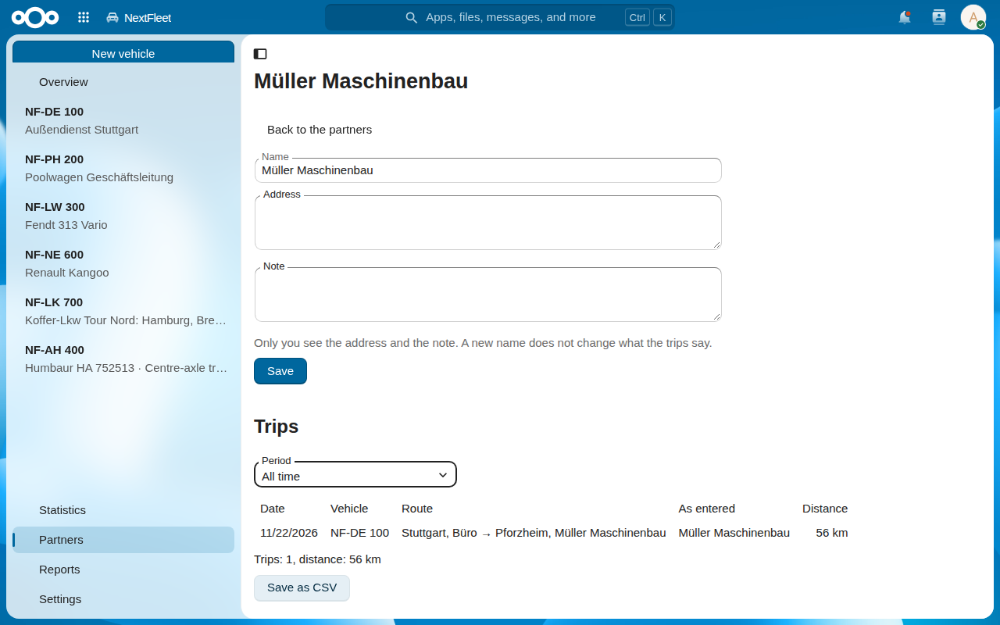
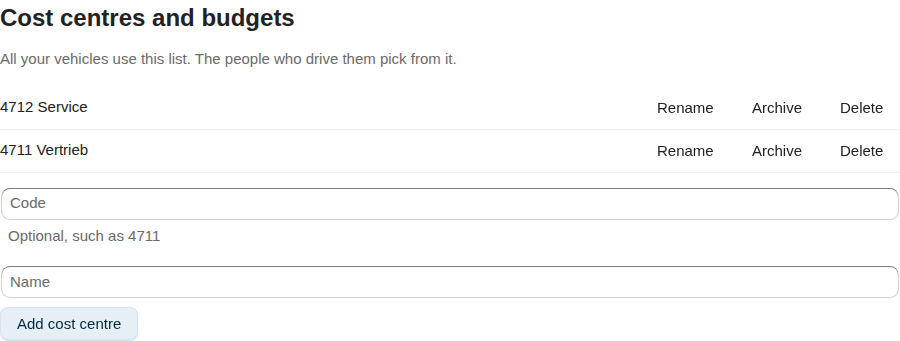
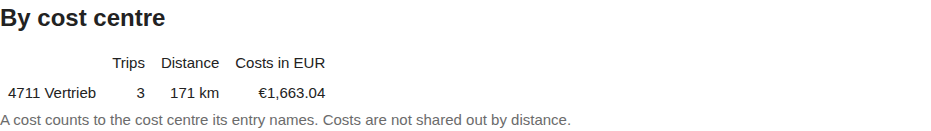
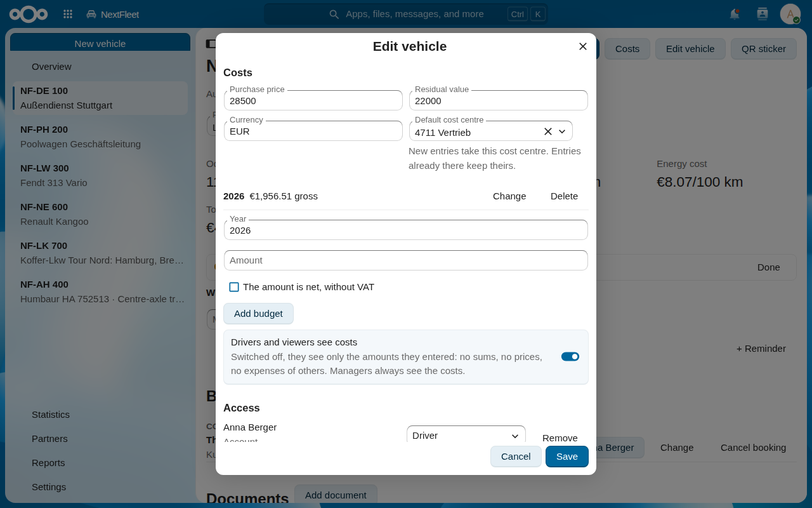
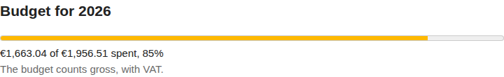

# Partners, cost centres and budgets

A business trip names the business partner you visited.
A trip or a cost can also name a cost centre.
NextFleet keeps your partners and your cost centres in two lists.
You can correct the partner list, merge two spellings of one partner, and see all trips to one partner.
You can also set a budget for each vehicle and year.

## Why the lists belong to the owner

The owner of the vehicles keeps one partner list and one cost-centre list for all of their vehicles.
A firm visits the same partner with every car, and puts the costs of every car on the same cost centres.
So one list of each is enough.
Other owners on the same server do not see your lists.
This keeps the partners of one freelancer away from another freelancer.

Drivers and managers of your vehicles see the names of your partners when they type a trip.
Viewers see the partner of each trip as it was typed, but not your partner list.
Only you see the address and the note.
Everyone who has access to one of your vehicles sees your cost centres, viewers too.
Drivers select from your cost centres, but they cannot add one.

## Partners

### How a partner gets on the list

1. Record a business trip, and type the **Business partner**.
2. Click **Save**.

   If the name is not on the list yet, NextFleet adds it.
   If you merged or renamed a name, a trip with the old name goes to that partner again.
   This works while a trip that is not voided still has the old name.
   A trip by a driver adds the partner to the list of the vehicle owner.

When you type a partner, NextFleet suggests the names on your list.
The partners of this vehicle come first, the most recent first.

The trip keeps the text that you typed.
The logbook shows this text.
A change to the list never changes the text of a trip.

### Open the Partners page

The navigation shows **Partners** when you own a vehicle.
It also shows **Partners** when your partner list is not empty.
So you can still answer a request to erase data after you deleted your vehicles or gave them to a new owner.
If you delete the last partner and own no vehicle, **Partners** goes away the next time you open NextFleet.

1. Click **Partners** in the navigation.

   The page shows your partners by name.
2. Click a partner to open it.
3. To go back to the list, click **Back to the partners**.

### Change a partner

1. Open the partner.
2. Change the **Name**, the **Address** or the **Note**.
3. Click **Save**.

The trips keep the text that they had.
Two partners on the list cannot have the same name.
If the new name is already on the list, merge the two partners.

### Merge two spellings of one partner

Two drivers can type one partner in two spellings, for example "Müller GmbH" and "Mueller GmbH".
The list then shows two partners.

1. Open the partner that must go.
2. Under **Merge**, select the other partner in **Merge into**.
3. Click **Merge…**.
4. Read the question, and click **Merge**.

   The trips of the first partner now belong to the other partner.
   The first partner is no longer on the list.
   The other partner opens.

The text of each trip stays as it was typed.
You cannot undo a merge.

### Delete a partner

A partner can be a private person.
A private person can ask you to erase their data.

1. Open the partner.
2. Under **Delete**, click **Delete…**.
3. Read the question, and click **Delete**.

   The name, the address and the note are deleted.

The text of each trip stays, because you must keep the logbook for ten years.
You cannot undo a delete.
A new trip with the same text adds a new partner to the list.

### See the trips to one partner

1. Open the partner.
2. Under **Trips**, select a **Period**: **Calendar year**, **Last 12 calendar months**, **All time** or **Between two days**.

   The table shows each trip of your vehicles to this partner.
   **As entered** shows the text of the trip.
   Under the table, NextFleet adds up the trips and the distance.
3. To save the trips as a file, click **Save as CSV**.

Only trips that are not voided show.
Vehicles that count engine hours show the hours.

## Cost centres

A cost centre is a part of your business that gets costs, for example a department or a project.
A trip, an energy entry, a maintenance record and an expense can each name one cost centre.

### Turn on cost centres

When you gave access to another user or a group, cost centres are on.
When only you use your vehicles, turn them on:

1. Open **Settings**.
2. Under **Cost centres and budgets**, turn on **Use cost centres and budgets**.

### Add a cost centre

1. Open **Settings**.
2. Under **Cost centres and budgets**, type a **Code** and a **Name**.

   The code is optional, for example `4711`.
3. Click **Add cost centre**.

Two cost centres cannot have the same code or the same name.

### Rename, archive or delete a cost centre

The list in **Settings** has three buttons for each cost centre:

- **Rename**: change the **Code** or the **Name**, and click **Save**.
  The entries show the new name.
- **Archive**: NextFleet does not offer the cost centre any more.
  The entries that name it keep it.
  To use it again, click **Offer again**.
- **Delete**: this works only while no entry and no vehicle names the cost centre.
  Otherwise, archive it.

### Set the default cost centre of a vehicle

1. Click **Edit vehicle**.
2. Under **Costs**, select the **Default cost centre**.
3. Click **Save**.

New entries of this vehicle get this cost centre.
The entries that are already there keep their cost centre.
The owner and the managers can set the default.

### Select the cost centre of an entry

1. In **New entry**, fill in the fields.
2. In **Cost centre**, select a cost centre, or clear the field for none.

   The field starts with the default of the vehicle.

Every driver sees this field, also a driver who does not see the costs.
An import and the trip of a returned booking get the default of the vehicle.

### See the costs and the distance of each cost centre

In **Statistics**, the section **By cost centre** shows each cost centre with its trips, its distance and its costs in the range.
The entries without a cost centre are in the row **No cost centre**.
The section shows when an entry in the range names a cost centre.

- A trip counts its distance to its cost centre.
- An energy entry, a maintenance record or an expense counts its cost to its own cost centre.
  NextFleet does not share costs out by distance.
- You see the costs only of the vehicles whose costs you see.
  Every user sees the distance.

The CSV files in **Statistics** > **Export** have the code and the name of the cost centre in the last two columns.

## Budgets

A budget is the amount that you plan to spend on one vehicle in one calendar year.
NextFleet compares the budget with the costs of the year: energy, maintenance and expenses.
The loss of value does not count.
The budget shows when cost centres are on (see [Turn on cost centres](#turn-on-cost-centres)).

### Set a budget

You must own the vehicle.
The vehicle must have a **Currency**.

1. Click **Edit vehicle**.
2. Under **Costs**, type the **Year** and the **Amount**.
3. If the amount is without VAT, turn on **The amount is net, without VAT**.

   NextFleet then also counts the costs without VAT.
   Your VAT setting in **Settings** does not change this.
4. Click **Add budget**.

   The budget is saved at once.

One year has one budget.
To change it, click **Change**, change the amount, and click **Save**.
To delete it, click **Delete**.
A budget is only one amount, so the delete does not ask first.

### Who sees the budget

The users who see the costs of the vehicle also see its budget.
The managers see it, but they cannot change it.

### See the budget in Statistics

1. In **Statistics**, select the vehicle.
2. In **Range**, select **Calendar year** and the year.

Under the costs chart, a bar shows how much of the budget the costs of the year use.

The bar counts the costs the same way as the budget warning: net or gross as the budget says, in the time zone of the owner.
So the bar can show a different sum than the chart above it.

### The budget warning

NextFleet tells you when the costs of the year reach 80 % of the budget, and again when they reach 100 %.
The managers of the vehicle get the same message.
The message comes in the notifications and by email.
Each message comes one time for each year.
If one entry takes the costs past 80 % and 100 % together, only the 100 % message comes.
If you increase the budget above the costs, the message can come again.

The year is the calendar year in your time zone.
NextFleet sends the email only when the vehicle sends reminder emails.

## When a vehicle gets a new owner

Your administrator can give a vehicle to a different owner.
The partners and the cost centres of the entries of this vehicle then go into the lists of the new owner.
A partner keeps its address and its note.
If the new owner has a partner with the same name, NextFleet uses that partner.
If the new owner has a cost centre with the same code, or else the same name, NextFleet uses that cost centre.
A partner that you deleted does not go to the new owner.
Your lists stay as they are.

## When your account is deleted

Your partner list and your cost-centre list are deleted too.
The text of each trip stays.

Next: [Reminders](reminders.md)
